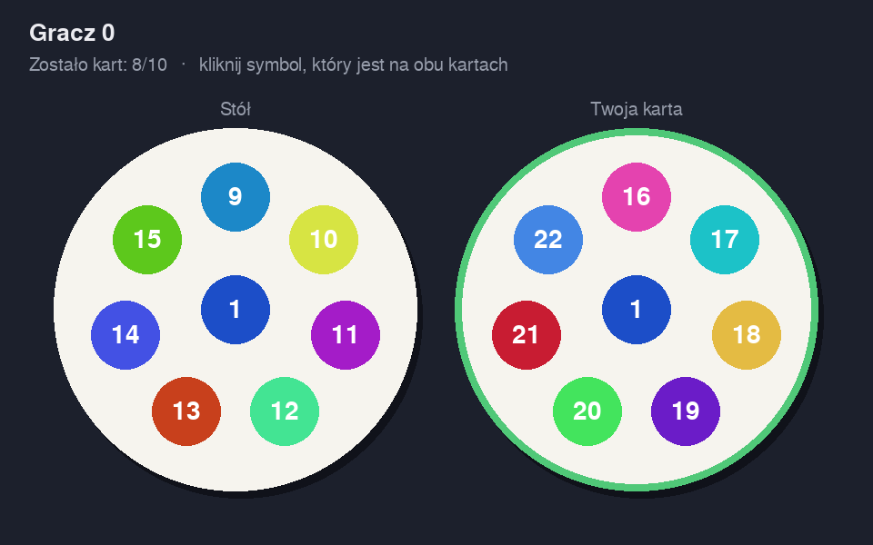
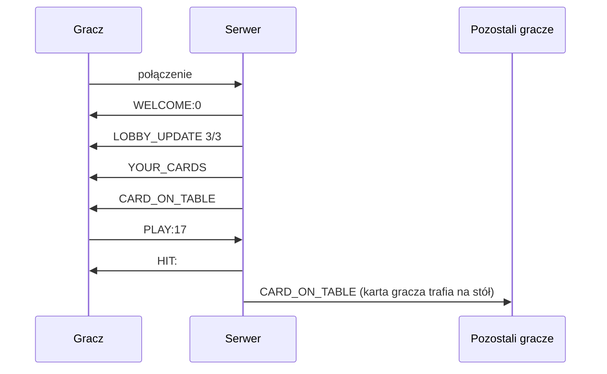

# Double – sieciowa gra Dobble dla 3 graczy

Wieloosobowa wersja gry karcianej **Dobble**: serwer w **C** (wątki POSIX, gniazda TCP, tekstowy protokół) i klient graficzny w **Python / Pygame**. Na każdej karcie jest 8 symboli, a każde dwie karty mają **dokładnie jeden** wspólny symbol. Wygrywa ten, kto pierwszy znajdzie wspólne symbole i pozbędzie się wszystkich swoich kart.

Projekt powstał na laboratoria z PWiR.



## Najciekawsze elementy

- **Talia generowana matematycznie:** 57 kart to [skończona płaszczyzna rzutowa](https://en.wikipedia.org/wiki/Projective_plane#Finite_projective_planes) rzędu 7 (7² + 7 + 1 kart i symboli). Serwer przy starcie sam sprawdza własność talii, czyli wszystkie **1596 par kart**:
  ```
  Talia: 57 kart, 8 symboli na karcie, niepoprawnych par: 0
  ```
- **Serwer autorytatywny:** klient wysyła tylko symbol, a serwer pilnuje, na której karcie jest gracz, i sprawdza trafienie. Klienta nie da się oszukać.
- **Współbieżność:** wątek na każdego gracza, wspólny stan stołu chroniony mutexem, więc tylko jeden gracz może „zabrać” daną kartę ze stołu.
- **Bot testowy:** `tools/bot.py` gra automatycznie, więc pełną rozgrywkę da się sprawdzić na jednym komputerze.

## Technologie

C (`pthread`, gniazda BSD) · Python · Pygame · Linux

## Protokół

Tekstowy, jedna wiadomość = jedna linia:

| Kierunek | Wiadomość | Znaczenie |
|---|---|---|
| S → K | `WELCOME:<id>` | przydzielone ID gracza |
| S → K | `LOBBY_UPDATE: Graczy w lobby: 2/3` | stan poczekalni |
| S → K | `YOUR_CARDS:1,2,…,\|9,10,…,\|…` | 10 kart gracza |
| S → K | `CARD_ON_TABLE:1,9,10,…` | aktualna karta na stole |
| K → S | `PLAY:<symbol>` | ruch gracza |
| S → K | `HIT:` / `NOT_ON_TABLE:` | wynik ruchu |
| S → K | `GAME_END:<id>` | koniec gry, ID zwycięzcy |



## Uruchomienie

**Serwer** (Linux / WSL):
```bash
cd Server
make
./dobble_server          # port 8000
```

**Klient** (×3, każdy gracz osobno):
```bash
cd Game
pip install -r requirements.txt
python Main.py           # inny komputer: DOBBLE_HOST=<adres IP> python Main.py
```
Klikasz symbol na swojej karcie, który jest też na karcie na stole.

**Gra z botami** (jeden człowiek + dwa boty):
```bash
python Game/Main.py &
python tools/bot.py --delay 2 &
python tools/bot.py --delay 2
```

## Struktura

```
Double/
├── Server/
│   ├── Server.c      # generowanie talii, lobby, logika gry, wątki
│   └── Makefile
├── Game/
│   ├── Main.py       # start klienta
│   ├── Client.py     # sieć: wątek odbierający, parsowanie linii
│   └── Gui.py        # Pygame: rysowanie kart, obsługa kliknięć
├── tools/bot.py      # automatyczny gracz do testów
└── docs/
```
